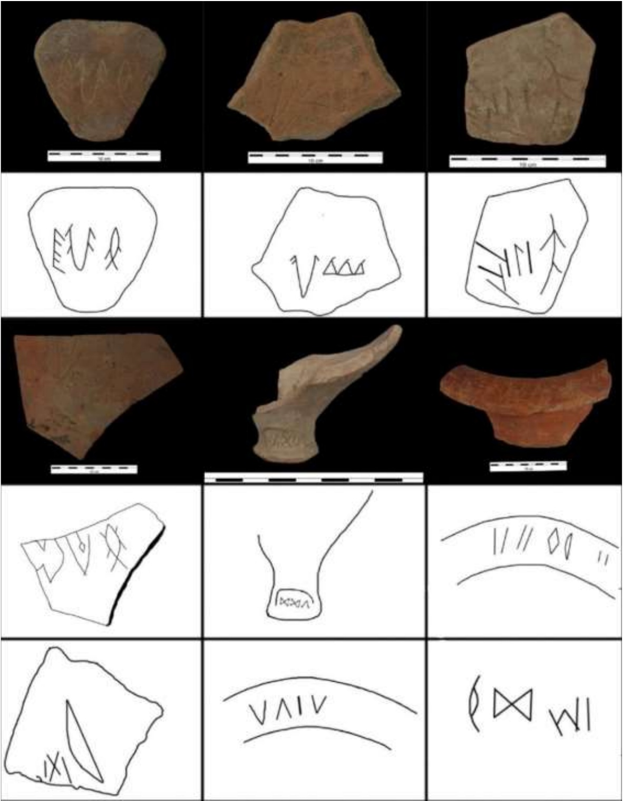

# Nine illustrated groups from Dholavira pottery

Vinod’s study records **185 graffiti observations, including nine examples the author classes as inscriptions**. I inspected Figure 13 in the public later article, which reproduces the three-column plate described as Figure 7 in the earlier chapter. There are nine distinct illustrated groups, six with both photos and drawings and three shown as drawings only. The sublabels A–I here are reference aids assigned in this review, read left to right across each group of three. They carry no implication about ancient reading direction. [Vinod, Figure 13 and discussion, pp. 356–358](https://heritageuniversityofkerala.com/JournalPDF/Volume10/22.pdf#page=11) · [Earlier chapter, Figure 7](https://www.academia.edu/41581628/Harappan_Graffiti_from_Dholavira)

## The usable observations

- **Middle, centre (E).** The photograph has a small mark near the base, consistent with the article’s description of a fine red-ware goblet with three stamped signs. The caption gives no accession tying the prose to that specific panel. In the published description, the mark was stamped during manufacture. The small image and drawing leave the exact signs open.
- **Middle, right (F).** A photograph and drawing preserve several stroke groups and lozenge-like outlines on a rim or brim fragment. The original vessel class, firing status of the marks and capacity are unavailable for this particular fragment. The stroke grouping can be investigated as a possible count.
- **Bottom, right (I).** A drawing shows a bow-tie that resembles sign 540, for which Cúper proposes a capacity measure. There is no photograph, vessel profile, accession or indicated position for this panel. No existing Dholavira Lipi row in the exported corpus contains 540. The resemblance is a candidate, with no new numerical coding.

The paper gives broad statements on when marks were made and where they occur, including stroke-like marks near the rim and shoulder. It does not join those variables to individual panels. I found **zero panels** with a secure proposed quantity sign, an independently identified storage jar and known firing timing together. The plate cannot score the proposed storage-jar comparison.

## Comparison with the existing corpus

The exported Lipi catalogue has **two pottery faces** for Dholavira. Lipi-5543.1 is a black ceramic fragment with one mark (455), provisionally “Arrow.” Lipi-5583.1 is a red fragment with accession DHR-488 and two recorded signs (081–740), provisionally “Of the [081] house.” None of the nine panels carries that accession or supplies a diagnostic match to either row. The triangle row in B is not a secure match for 455, whose catalogue shape places one large and two smaller triangles at a common vertex. DHR-488 is fragmentary, so missing identity information leaves duplicate status open.

I also screened the Dholavira records catalogued as tablets or miscellaneous objects, because Vinod includes a triangular terracotta cake described as bearing comb, jar and fish shapes. No object-level link was established. The nine image groups are preserved as source records for matching. They are not counted as nine new independent corpus texts. The excavation report describes graffiti on several materials and a Stage III painted three-sign sherd, but those descriptions do not identify individual panels in Vinod’s figure. [Bisht 2015, §§8.1.3 and 8.2](https://www.scribd.com/document/262316120/Excavations-at-Dholavifra-1989-2005-RS-Bisht-2015)

[Complete figure inventory](figure_review.csv). Crop from Vinod, Fig. 13, p. 357, photographs and drawings credited to ASI. No glyphs were restored. Colab units used 0.
