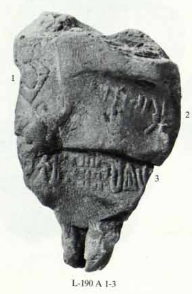
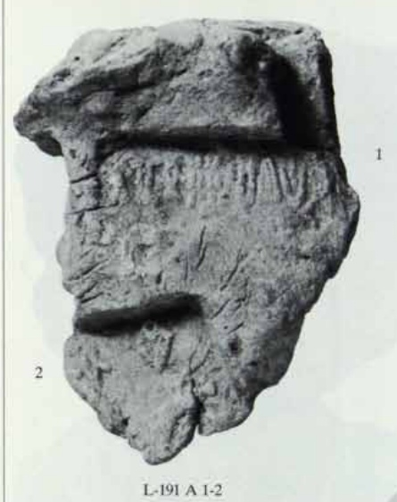
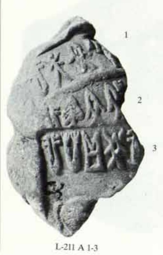
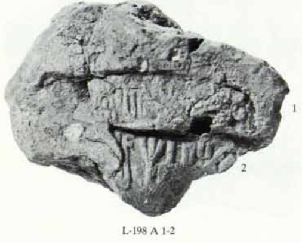

# What the Lothal clay preserves about stamp order

The original plates show a concrete mismatch on **L-190**. The long inscription Cúper provisionally reads as **“Manager of the Single-House 1 Twelve-Star House”** is **impression A3** in the published photograph and **face 2112.1** in the numeric corpus. Joining by the suffix would assign that reading to the single fragmentary glyph at A1. The long line and its distinctive grouped strokes can also be compared with the same formula at A1 on L-191. These are two impressions of the same written formula, so the photograph positions alone provide no order comparison.

| L-190 impression in CISI | Corpus face | Existing proposal |
| --- | --- | --- |
| A1, small fragment at left | 2112.3 | [880], unassigned |
| A2, partial middle line | 2112.2, by elimination | [317], two months, three [lost sign] |
| A3, long lower line | 2112.1 | Sea-voyage, Manager of the Single-House 1 Twelve-Star House |

L-190 comes from the warehouse at Lothal. The stored findspot is SRG 3GX 10, recorded depth −3.33 ft, excavation number 01870. Frenez classifies its backing as a structure and illustrates it as a small wooden cage. [CISI plate, printed p. 282](https://ignca.gov.in/Asi_data/76884.pdf) · [Frenez 2020, figs. 7 and 9](https://doi.org/10.5281/zenodo.5513821)

## Orders visible in the clay

| Object | Existing proposed texts | Physical observation |
| --- | --- | --- |
| **L-211**, wooden-box backing | Middle A2 “Of the [lost sign]-Two-Star-Scabbard-fish-King house” and lower A3 “Of the [lost sign]-High-star child of Town house” | Best supported partial order is A2 before A3. The lower impression has a continuous top and left rim across the field beneath the middle inscription. Frenez and Tosi describe successive impressions leaving earlier legends exposed. The comparison is between two proposed house labels. A1 relative to A2 was left open. |
| **L-198**, warehouse, structural backing | Upper A1 tentatively “Two [lost sign], dozen” and lower A2 “Of the [lost sign]-Four-Chest-Cotton house” | The lower impression's sharp corner and rim could cut into the upper impression. This would put the apparent quantity **before** the house label. The crossing and panel assignment both remain provisional. Frenez and Tosi identify overlap and report heavy concretions and fractures on this specimen. |
| **L-191**, jar backing | A1 “Manager of the Single-House 1 Twelve-Star House” and A2 “Two shares: Bamboo-star” | Both impressions are now visible in the full plate. Wear and cracks at the boundary prevent a secure directional call. |

## What was reviewed

Frenez's 2020 table lists **31 objects with multiple impressions** within its 93 Lothal records. The 31 objects carry **71 published impressions**. Local catalogue extracts covered 22 objects. The original printed CISI plates, pp. 274–289, supplied views for all 31, including the missing nine. The source plates also recovered the front view of L-190 when the image archive contained only side views. [CISI plates](https://ignca.gov.in/Asi_data/76884.pdf) · [Frenez 2020 table 2 and photographs](https://doi.org/10.5281/zenodo.5513821)

I looked for a stamp edge that continues across another impression's field, with a visible interruption of that other impression. A shadow, sharper stamp, crack, or adjacency was inadequate by itself. This was a single reviewer working from reproductions and with prior knowledge of some examples. The role comparison had **zero secure name–quantity pairs**. It remains unscored. The sample contains a published overlap on L-193 whose direction was unresolved here, one source-supported partial order on L-211, and one tentative direction on L-198. No statistical inference uses the other possible contacts.

Frenez and Tosi's earlier report counts **two spaced geometric impressions** on L-174. Both are visible on CISI p. 279. Frenez's 2020 table counts one. L-174 is a supplementary check outside the fixed 31-object screen and supplies neither a directional crossing nor a proposed name–quantity pair. The CISI panels and successive publications also differ on some other impression counts. [Frenez and Tosi 2005, pp. 75, 79–80](https://doi.org/10.5281/zenodo.5514283) · [CISI p. 279](https://ignca.gov.in/Asi_data/76884.pdf)

Cúper already inspected some objects and noted the three overlapping impressions on L-211. He tested catalogue listing order for two-role objects and explicitly distinguished it from physical order. L-190 has three impressions and falls outside that two-role subset. The new work is the plate-by-plate assessment and the alignment of physical panels with corpus faces. [Existing stamp report](../../../../../jobs/out/stamps.md) · [Existing order test](../../../../../work_scripts/lump_2_pairs.py)

[All 31 judgments with contexts and existing readings](review_with_context.csv) · [Panel alignment and sign sequences](aligned_readings.csv) · [Counts](summary.json)

Rerun with `python research/independent_validation_20261120/context_associations/lothal_stamp_order.py`. The input photo decisions are in `plate_review.csv` and `panel_alignment.csv`. The four crops reproduce the labels and photographs from CISI I pp. 282–284 and 288. Colab units used 0.
