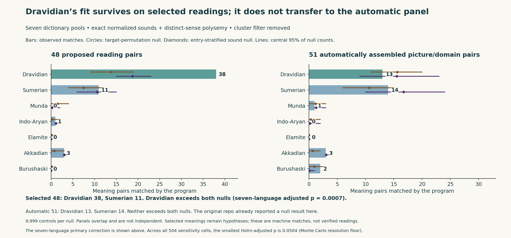

# Expanded dictionary comparison: what survives the filter diagnostic?

20 November 2026 local / 21 November UTC. Completed after the small known-Sumerian pilot. **The twelve-pair tie does not generalize to all proposed readings.** Removing the disputed cluster exclusion leaves Dravidian at **38/48** on the previously frozen meaning pairs, versus **11/48** for Sumerian, using exact normalized sounds plus distinct-sense polysemy. Dravidian exceeds both specified chance baselines on that selected panel. On the broader **51 automatically assembled picture/domain pairs**, the same rule gives **13/51 Dravidian and 14/51 Sumerian**, with neither exceeding both baselines.

The measured distinction is **fit to selected meanings versus transfer to the automatic source-domain panel**. The filter problem is real and persists, but it does not explain away the whole selected-panel Dravidian advantage. The automatic panel is not fresh archaeological evidence; its original-filter null result already existed in the repository.



## What ran

The [analysis plan](PLAN.md) and [case inventory](cases.json) were frozen before expanded scoring. Six panels were tested across seven dictionary pools, three normalizers, two cluster rules, and two phonetic/polysemy channels: **504 result cells** and **1,246 case-language rows**. Each cell has **9,999 target-domain permutations**, **9,999 entry-stratified sound controls**, and **9,999 legacy-cluster-preserving sound controls**. The same target permutations are shared across languages for pairwise comparisons. The complete run took 68.88 seconds locally; no Colab units were used.

The panels contain 178 rows altogether, but overlap in signs, words and source searches. **178 is not an independent sample size.** The original twelve-pair regexes are unchanged, while the 48-pair panel uses the concept lists frozen for the earlier language-portability study. These inventories are not nested or semantically identical. Every candidate from the 30-, 13- and 24-row source tables is included, even when the earlier search failed or the candidate was not promoted.

The 163-row master is fully accounted for in [master_scope.csv](results/master_scope.csv). Seventy-one master signs occur directly in at least one paired panel. Other master rows include numerals, literal readings, compounds and allographs, or have no two-sided pair in these frozen source panels. They are not silently credited as additional lexical tests. Other tested source candidates need not be in the promoted 163-sign master.

The known-answer Sumerian pilot still has three independent sign groups. This expansion tests the **Indus-side consequences of the diagnosed filter**, rather than pretending to have collected hundreds of new independently known ancient rebuses.

## The primary 48-pair result

“Match” means the program found either two distinct dictionary entries with a common normalized sound key, or one entry with the two concepts in distinct listed sense clauses. Vowel length is folded by the unchanged source normalizer; consonant distinctions are retained. The uniform entry rule removes the disputed generated-cluster exclusion; it does not repair historical etymology.

| Pool | Matches /48 | Both domains present /48 | Mean target-null hits | Mean sound-null hits | Primary Holm p |
| --- | --- | --- | --- | --- | --- |
| Dravidian | 38 | 48 | 13.79 | 18.72 | 0.0007 |
| Sumerian | 11 | 45 | 7.45 | 10.57 | 1 |
| Munda | 0 | 39 | 1.46 | 0.29 | 1 |
| Indo-Aryan | 1 | 42 | 0.27 | 1.14 | 1 |
| Elamite | 0 | 18 | 0.12 | 0.02 | 1 |
| Akkadian | 3 | 31 | 0.74 | 3.03 | 1 |
| Burushaski | 0 | 28 | 0.10 | 0.02 | 1 |

The two randomization requirements are combined conservatively by taking the larger p-value, then applying Holm correction across the seven primary languages. For Dravidian both unadjusted p-values are **0.0001**, the Monte Carlo reporting floor, giving **0.0007** after that correction. Zero of 9,999 controls exceeded or tied the observed primary count under either null; this is not an exact probability of 0.0001 or a probability that the language hypothesis is true.

The direct Dravidian–Sumerian difference is **27 matches**, against **6.35** expected from shared target permutations. Its upper-tail p is 0.0001, **0.0006 after six rival comparisons**. Restricting to the **45 pairs with both semantic sides represented in both dictionaries** leaves **36 Dravidian versus 11 Sumerian**, with the same adjusted p at this resolution. Coverage alone therefore does not remove this selected-panel difference. It also does not make the dictionaries linguistically equivalent.

Across **all 504 correlated sensitivity cells**, the smallest global Holm-adjusted p is **0.0504**. With 9,999 controls, 504 × 0.0001 is already 0.0504: that broader correction is limited by the chosen Monte Carlo resolution. We report this rather than describing every sensitivity as independently significant or increasing the controls after seeing the result. The seven-language primary comparison was specified in advance of this expanded run; its result must still be interpreted conditional on prior Dravidian-oriented selection of the meanings.

## Does the result survive the broader source panels?

| Source panel | Dravidian | Sumerian | Drav. target p | Drav. sound p | Drav. within-panel Holm p |
| --- | --- | --- | --- | --- | --- |
| 48 fixed reading pairs | 38 | 11 | 0.0001 | 0.0001 | 0.0007 |
| 51 automatic picture/domain pairs | 13 | 14 | 0.9011 | 0.8029 | 1 |
| 12 original baseline pairs | 8 | 7 | 0.106 | 0.0153 | 0.742 |
| All 30 Key4B candidates | 22 | 17 | 0.0228 | 0.0861 | 0.5166 |
| All 13 Key5A candidates | 10 | 2 | 0.0045 | 0.0044 | 0.0315 |
| All 24 Key6A candidates | 16 | 4 | 0.0064 | 0.0624 | 0.4368 |

All counts use the same uniform-entry exact-plus-polysemy scorer. The final column corrects the larger of the two p-values across seven languages *within that panel*; the global correction is separate.

On the **automatic 51**, Dravidian's 13 hits fall below both null means (**15.60 target permutation; 15.53 sound reassignment**). Sumerian's 14 compare with **10.64 and 16.76**; it also fails the requirement to exceed both. No language passes the panel's seven-language correction. Dravidian's difference from Sumerian has p=0.9617 in the claimed-advantage direction. This does not establish Sumerian as the winner.

The later search tables are mixed. Key5A's Dravidian result passes its within-panel correction (**p=0.0315**); Key4B and Key6A do not pass both requirements after correction. Key6A beats its target permutation baseline but not its sound baseline at 0.05. These are overlapping searches made while developing the hypothesis, not independent replications. [summary.csv](results/summary.csv) reports all seven pools, all modes and both sound nulls.

## How much does the cluster rule matter now?

| Source panel | Dravidian: original → uniform | Sumerian: original → uniform |
| --- | --- | --- |
| 48 fixed reading pairs | 31 → 31 | 5 → 10 |
| 51 automatic picture/domain pairs | 10 → 10 | 9 → 14 |
| 12 original baseline pairs | 7 → 7 | 5 → 7 |
| All 30 Key4B candidates | 19 → 19 | 11 → 16 |
| All 13 Key5A candidates | 8 → 8 | 0 → 2 |
| All 24 Key6A candidates | 11 → 11 | 2 → 4 |

These are **phonetic-only exact counts**: the twelve-pair row reproduces the earlier 7–5 to 7–7 example without conflating it with polysemy. The unchanged original strict counts for both the twelve-pair and automatic fifty-one-pair panels reproduce the committed source tables for all seven pools.

The original Sumerian strict exact count also changes when identical source rows are reversed: **5 → 3** on the fixed 48 and **9 → 4** on the automatic 51. Uniform-entry counts stay **10 → 10** and **14 → 14**. The exact-plus-polysemy version is also order invariant under the uniform rule. All other language/panel results and order checks are in [row_order.csv](results/row_order.csv).

Akkadian and Burushaski have zero eligible exact edges under the original cluster filter, as in the pilot; removing it makes their exact channel capable of scoring. Some new counts come from polysemy, a separate channel. This confirms the unequal mechanical opportunity to score, but the 48-pair Dravidian lead remains substantial after the exclusion is removed.

## What do individual matches actually represent?

Every candidate witness is preserved in [witnesses.csv](results/witnesses.csv), not just the first pleasing example. A post-run provenance check, which changes no scores or nulls, classifies the 48 Dravidian cases as **35 with a witness using the originally cited etymon IDs, three with alternative-only machine matches, and ten without an exact/polysemy match**. Etymon-ID agreement is provenance, not a word-sense or archaeological validation.

Concrete examples:

- **Bow → sell, sign 892:** the source pool supplies *vil* in DEDR 5422 for bow and 5421 for sell. This is a direct same-key connection using the proposal's cited entries.
- **Jar → house, sign 740:** *kuṭam* and *kuṭi* are not exact matches; the existing stem rule gives *kuṭ*. It must not be counted as an exact hit merely because the proposed roots look related.
- **Fish → star, sign 220:** the regenerated pool's cited 4876 gloss contains **flash, glitter, lightning, shine**, not **star**. Consequently the fixed **star/constellation/asterism** pair receives no exact/polysemy hit, whereas the older twelve-pair **star/shine/glitter** regex can hit. A shining-word match must not be silently described as direct evidence for a star meaning.
- **Comb → small/junior, sign 400:** the exact-plus-polysemy program finds an alternative entry, DEDR 1610, with **comb** and **a small cluster or bunch of plantain fruits**. That does not establish a word meaning junior. The earlier proposed *cikkam/cikka* connection is instead a stem sensitivity. This is a concrete warning that a program match is not automatically an acceptable reading.
- **Sumerian bowl → measure:** *bur* has bowl/pot and surface-measure entries; the original same-cluster exclusion removes this candidate. Allowing it is useful for comparing dictionaries, but does not show that the Indus sign was pronounced *bur*.

[reading_provenance.csv](results/reading_provenance.csv) lists every primary claim and its original/alternative witness classification. It is not a manually validated count of 35 translations. Pooling forms and senses within source etymological entries can cross language and dialect boundaries; the Dravidian pool remains the source's Tamil-first two-branch representation, not a reconstruction of a single ancient speaker's lexicon.

## What is new relative to the repo?

The old repo already supplied the original 12- and 51-pair tests, their null controls, and the later candidate searches. Our earlier work supplied the frozen 48-pair concept inventory and the small known-script filter counterexample. **New here** are the complete seven-language filter comparison on all six inventories; recalculated domain and two sound nulls for both filtering choices; shared-permutation language-advantage tests; common-coverage comparisons; order-reversal tests across the larger inputs; all-candidate inclusion; and the explicit original-root/alternative witness classification.

This result **narrows the criticism**: the disputed filter overstates some comparative differences, but it cannot account for the whole Dravidian fit to the selected 48 pairs. That fit is stronger than these conditional randomizations. The unresolved question is whether the selected Indus meanings are independently correct and predict fresh evidence. Randomizing words after those meanings were chosen using Dravidian cannot answer that question. The automatic-source-domain result supplies no positive transfer evidence under this test, and was already null under the original repo's scoring.

## Reproduce and verify

Python 3.9–3.12, repository root; large external source files are not added here. Regenerate the isolated candidate lexica using the preceding positive-control runner. Dictionaries and upstream scorers remain unchanged.

```sh
python -m pip install -r research/independent_validation_20261120/expanded_rebus_test/requirements.txt
python research/independent_validation_20261120/rebus_positive_control/run.py --cache /tmp/ivc-positive-lexica
python research/independent_validation_20261120/expanded_rebus_test/freeze.py
OPENBLAS_NUM_THREADS=1 VECLIB_MAXIMUM_THREADS=1 python research/independent_validation_20261120/expanded_rebus_test/run.py --cache /tmp/ivc-positive-lexica --n 9999
python research/independent_validation_20261120/expanded_rebus_test/check.py --cache /tmp/ivc-positive-lexica
python research/independent_validation_20261120/expanded_rebus_test/inspect_readings.py
MPLCONFIGDIR=/tmp/ivc-positive-mpl python research/independent_validation_20261120/expanded_rebus_test/plot.py
python research/independent_validation_20261120/expanded_rebus_test/write_report.py
```

Checks passed for all 504 cells: source hashes; unchanged original count reproduction; packed scoring against the unmodified source engine under sound permutations; independent brute-force word-pair checks; explicit-loop domain-permutation counts; null/observed monotonicity; p-value recalculation; multiplicity correction; and uniform-rule order invariance. The rebuilt Munda pool has **1,416 entries versus the stored run's 1,417**; both reproduced panel hit counts remain zero. This drift is recorded in [reproduction.csv](results/reproduction.csv), rather than claiming bit-for-bit identity of the original environment.

All null arrays and domain matrices are in [nulls_and_matrices.npz](results/nulls_and_matrices.npz); every input/code hash, seed and runtime is in [run.json](results/run.json). Candidate source records are the existing repository lexica referenced by those hashes. German translations are visible in freeze.py and were not tuned after scoring; German gloss coverage remains less comparable than an independently curated multilingual lexicon.
