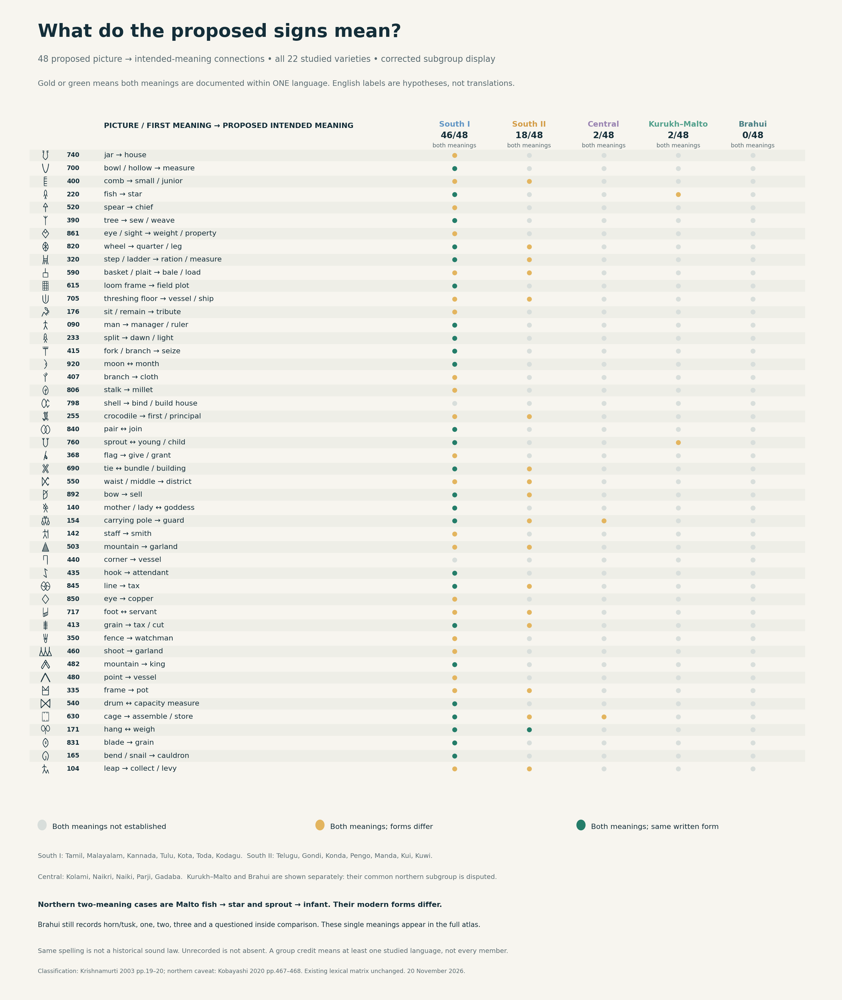
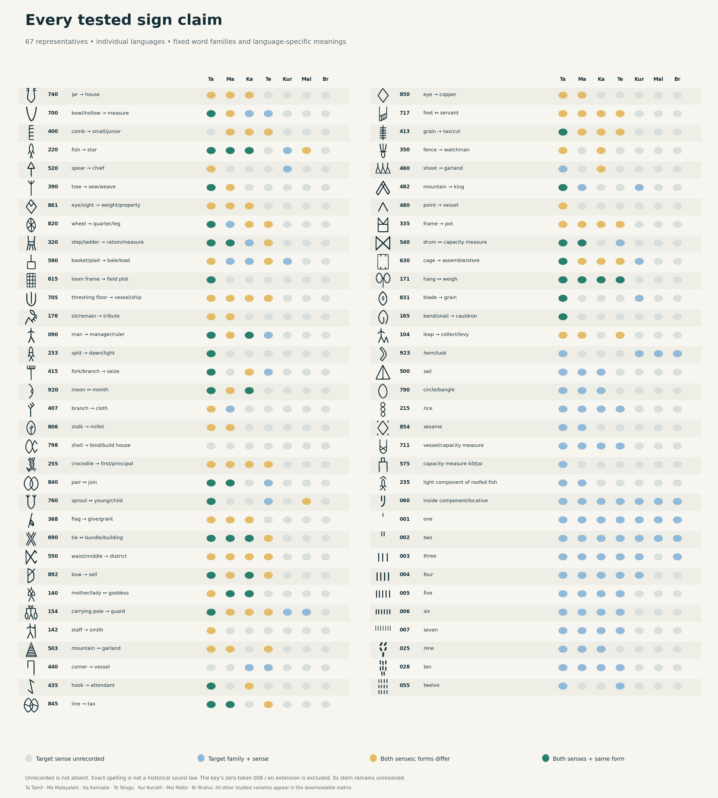

# Which proposed Indus connections survive across Dravidian?

20 November 2026. Continuation of the existing 163-sign proposal at upstream commit `727dfd411a4faa44d193d204757540d45c7b139b`.

**Follow-up:** [chronology, subgrouping and what is genuinely new](chronology_and_branching.md). This check caught Kannada *māle* “garland,” explicitly labelled a Sanskrit tatsama, being counted as inherited; the current matrix and chart exclude it. The northern result and Venn region counts are unchanged.

**The larger comparison identifies specific northern retentions, but no overall northern concentration in the proposal's fixed word families.** The clearest geographically restricted example is the horn family: Tamil **maruppu**, Kurukh **marᵃg**, Malto **margu**, Brahui **marg̠ẖ**. Among the 22 varieties examined, DEDR 4720 documents this family in those four. This is a useful Tamil–northern distribution to follow, not a northern-exclusive innovation. The earlier small-panel report already noted the horn lead; this pass checks its distribution in the larger material.

For the actual proposed meaning pairs, Malto preserves both families/senses for **fish → star**, with different recorded forms, and the **sprout ↔ infant** family, with related derived forms. Brahui and Kurukh have several individual components but no two-sided match to the fixed pairs under the stated sense rules. The result does **not** identify the Indus language as Northern Dravidian, or identify a modern language as its closest descendant.



The circles pool languages for readability. Membership means **at least one language** in each named group; it does not mean every member, and the display groups are not proposed phylogenetic branches. The two meanings must occur within the **same individual language** before its group receives credit. All 22 individual results are downloadable below.

## What was actually compared

The comparison fixes **67 representative sign claims**, including **48 rebus/polysemy meaning pairs**, against **107 distinct cited etymological groups**. Repeated sign variants and compounds are not counted as independent lexical discoveries. [claims.json](claims.json) records each sign, proposed root, original source note, meanings and dictionary anchors. The complete 163-row key is accounted for in [key_scope.csv](results/key_scope.csv); unscored entries are explicitly marked.

The key's zero-token `008 / *eṇ` extension is excluded. The ordinary numeral eight family, *eṭṭu* (DEDR 784), would not by itself verify the proposed *eṇ* stem. No glyph was fabricated for this extension.

This goes beyond the 100-word list:

- **75,589 DEDR source records** for the 22 selected varieties, from the full 76,036-row structured transcription. Gondi and other source dialect IDs are collapsed into their parent language; Naiki and Naikri remain separate.
- **3,483 Brahui glossary records** from Ali–Kobayashi, plus 19 records from the Emeneau material, searched for alternatives and source loan labels.
- **The complete Malto glossary**, printed pp. 428–460 of Kobayashi 2017: 2,433 entries with quoted definitions recovered from its two-column text layer. Another 194 unquoted entries are not treated as translated lexical definitions.
- **The complete Grignard Kurukh dictionary OCR**, covering the 697-page dictionary in a 714-page scan, searched separately. This is a full-text review screen, not a clean headword database. The modern Kurukh sources contribute another 3,821 records across surveys and grammar materials.
- Additional southern material supplies 2,904 records in the selected languages. It is supplementary vocabulary, not an independent replication of DEDR.

The structured source total is **88,249 records**, excluding the separate Grignard OCR screen. Records, distinct headword strings, etymological families, senses and independent words are different units. Dialect repetitions and inflected forms inflate record counts. See [language_summary.csv](results/language_summary.csv) and [summary.json](results/summary.json). This is a substantial accessible vocabulary search, **not exhaustive dictionaries of every Dravidian language**.

## All languages, some languages, different senses

| Proposed sign connection | What recurs | What differs or remains unresolved |
|---|---|---|
| `001` one; `002` two | Their cited families and numeral meanings are recorded in **all 22** varieties. | These are broad retentions; they do not distinguish Northern Dravidian. Cognacy does not require identical modern spelling. |
| `003` three | The cited family/sense is recorded in **18/22**, including Brahui and Kurukh. | Malto has another recorded numeral; non-attestation in this family is not absence of the concept. |
| `923` horn/tusk | DEDR 4720: **Tamil + Kurukh + Malto + Brahui**. Malto's recent glossary also has *margu* “horn.” | A particularly interesting northern-heavy retention, shared with Tamil. The sign's horn meaning remains a proposal. |
| `861`, `850` eye/sight | Tamil *kaṇ*, Kurukh *xann*, Malto *qanu*, Brahui *xan* belong to the eye comparison. Brahui **xaning** “see” is explicitly recorded under DEDR 1443. | Eye/see does not establish the second sense **weight/property** or **copper**. The copper proposal also erases a Tamil nasal distinction in its ASCII comparison. |
| `220` fish → star | Exact same-form pairs occur in Tamil, Malayalam and Kannada, and also Kota/Toda in the full table. Malto retains both families: **mínu** fish / **bínḍke** star. Kurukh has **bīnkō** star. | Malto's modern forms are not homophones. Kurukh's star word does not supply a fish word of that same family. Brahui's *istār* is reported as a loan, with disagreement over donor attribution. |
| `760` sprout ↔ infant | Malto **qóroce** “sprout” / **qóro** “infant” occur within DEDR 2149. Related sprouting vocabulary includes Kurukh **xōrnā**, Brahui **xarring**. | The infant meaning is not documented for those Kurukh/Brahui forms in the checked etymological records. Malto has an attested derivational connection; its failure of exact-headword matching is not a rejection of that connection. |
| `171` hang ↔ weigh | Southern records explicitly combine hanging and weighing, e.g. Tamil **tūkku**, Kannada **tūgu**, Telugu **tū̃gu**. | The same broader DEDR 3376 comparison reaches Kurukh **tungul** “dream,” Malto **tumgle** “dream,” Brahui **tug̠ẖ** “sleep/dream.” Shared family membership alone would wrongly import the weighing meaning into the northern languages. |
| `892` bow → sell | Tamil **vil**, Kannada **bil** provide same-form pairs. Historical Brahui **bil** “bow” is recorded in DEDR 5422. | No Brahui selling sense is established for *bil*. The recent glossary also records *kamān* “bow,” marked Farsi. A loan synonym does not show that the older bow word vanished. |
| `520` spear → chief | Tamil *vēḷ* chief and Kurukh **bēlas** king are compared in DEDR 5545. | The spear family is separately anchored in 5536. Kurukh's chief word alone is one side of the proposed connection. |
| `140` mother/lady ↔ goddess | Brahui **ammā** “mother/grandmother/respectful address” shares the mother family. | The checked Brahui entry does not supply “goddess.” Mother → goddess is explicitly combined in some southern entries. |
| `845` line → tax | Tamil and Malayalam **vari** preserve the same-form pairing. | Brahui **sung** “tax” is an actual glossary alternative; its unmarked origin is **unclassified here**, not proof of native inheritance or a Persian loan. |
| `740` jar → house | The original jar/house families have documented southern senses. | Brahui **urā** “house/home” belongs to another, partly disputed comparison; **xāna** “house” is marked Farsi. Neither automatically verifies *kuṭi*. |
| `400` comb → small/junior | Comb words occur in several southern languages; Kannada *cikka* means small/young. | Tamil's cited *cikka* entry says “in brief/in a nutshell,” rather than the required ordinary “small/young.” Meanings cannot be borrowed from Kannada to manufacture a Tamil pair. |

The [complete overlap sets](results/overlap_sets.csv) enumerate languages with and without recorded support for **every tested claim**. “Unattested” means the checked sources did not establish that specific family/sense; it never means the language lacks the word or concept.



## Does the full Kurukh dictionary add connections?

Yes, it supplies additional **semantic parallels using other words**. Direct scan checks found:

- **bōlō**, Grignard p. 94 / PDF p. 109: freshly emerged or tender plant material, and a recently born/young person. This parallels the sprout/young idea. Its relationship to the proposal's particular *iḷa/koẓ-* families is not established here.
- **atya'ana** (search transcription), p. 41 / PDF p. 56: tying wood, grass or paddy into bundles. This parallels tie/bundle, without establishing the proposed *kaṭṭu* family.
- **candō** (search transcription), the moon/month entry: the semantic pairing exists in Kurukh using a different word from proposed *tiṅkaḷ*. Origin is not assigned by this screen.
- **jokhnā**, p. 335 / PDF p. 350, explicitly weighs with scales; it is useful replacement vocabulary, not evidence that the sleep/dream family itself means weigh.

Similarly, Malto **musge** “pack up/tie into a bundle,” DEDR 4915, preserves tie/bundle semantics using another family. These are useful exploratory leads. They are not confirmations of the original sound values, independent sign meanings, or northern-specific innovations. Their presence also illustrates why a missing elicited form cannot be equated with a lost word.

[kurukh_ocr_screen.json](results/kurukh_ocr_screen.json) reports the full search size. [kurukh_ocr_candidate_queue.csv](results/kurukh_ocr_candidate_queue.csv) retains every fixed-pair paragraph co-occurrence for review. Paragraphs can contain examples, unrelated adjacent entries or only part of an entry. The queue is **unscored**, and a clean exhaustive transcription of the full Kurukh dictionary is not claimed.

[exploratory_review.csv](results/exploratory_review.csv) distinguishes checked semantic parallels from keyword accidents, such as an iron hook being mistaken for a smith or a verb mentioning a sack being mistaken for a word meaning sack.

## Recorded fit of the original pairs

| Language | Structured records searched | Target family/sense /67 | Both senses /48 | Same form /48 | Same or one edit /48 |
|---|---:|---:|---:|---:|---:|
| Tamil | 12,196 | 64 | 44 | 24 | 40 |
| Malayalam | 8,210 | 50 | 30 | 8 | 17 |
| Kannada | 11,268 | 42 | 24 | 7 | 16 |
| Telugu | 8,305 | 37 | 18 | 1 | 8 |
| Kurukh | 5,305 | 13 | 0 | 0 | 0 |
| Malto | 3,637 | 7 | 2 | 0 | 0 |
| Brahui | 3,987 | 5 | 0 | 0 | 0 |

The table concerns **fixed original etymological families**, not generic synonyms. Larger unetymologized glossaries are searched for alternatives but cannot establish inherited family membership merely by sharing a meaning. The source has 763 candidate exact-headword supplement links; these remain unscored because same-language homonyms still require checking. Brahui's five target matches include the explicitly questioned inside comparison; excluding questioned records leaves four.

“Same form” preserves vowel length and consonant distinctions after Unicode normalization and documented IPA/roman equivalences. It does not strip arbitrary endings or conflate Tamil *ṇ/ṉ*. The one-edit column is an exploratory spelling sensitivity, not a sound law. Attested morphology, such as Malto *qóro-ce*, can provide a real connection even when neither spelling criterion passes. Consequently the zero northern exact count is a description of this conservative screen, **not a proof that northern speakers could never use a corresponding rebus**.

The current key was constructed using Tamil-first lexical selection. Tamil's lead therefore describes portability of that key; it is not an unbiased contest in which ancient Indus has independently selected Tamil. Dictionary sizes, semantic coverage, literary history, source dependence and reconstruction uncertainty also differ.

## Coverage-matched northern comparison

Across the **107 distinct fixed etyma**, root-family presence is Brahui **16**, Kurukh **27**, Malto **20**. At least one northern language appears in **40**, and all three in **8**. These include families retaining different meanings.

We sampled 4,999 rival root inventories from 5,544 numeric DEDR groups, preserving **exact documentation breadth across the 22 varieties and Tamil presence**, jointly, for every stratum. Expected counts were about **15.1**, **26.7**, **24.7**, **38.6**, and **7.2**, respectively. None of the six northern enrichment endpoints is significant; all six Holm-adjusted p-values are **1.0**. Complete results, including the Kurukh–Malto joint endpoint, are in [northern_controls.json](results/northern_controls.json).

This improves on raw overlap counts by controlling two large dictionary effects. It still tests **documented cognate distribution**, not independently assigned Indus meanings or language ancestry. It cannot remove the original selection of concept pairs or all source biases.

## Brahui loans and uncertain origins

The recent primary glossary explicitly marks **xāna** house, **kamān** bow and **narīna** male as Farsi, and **sara** head as Balochi. It also contains unmarked alternatives such as **sung** tax and **kašš-ing** pull/sell. Unmarked means no donor label in that entry; it does not establish ancient Brahui inheritance.

For **istār** star, the Ali–Kobayashi glossary prints `[E]` (English), verified at printed p. 705 / PDF p. 716. The earlier Bray-based annotation attributes it to Persian, and the earlier short-list source suggested Hindi. We preserve the disagreement and do not select an immediate donor from superficial resemblance. All these attributions separate it from an established inherited *mīn* fish/star pair. Source loan labels do not by themselves date a borrowing to before or after the Harappan period.

## What this adds, and the IVC implication

The underlying etymologies are existing linguistic evidence. New here are the **IVC-specific 67-by-22 family/sense matrix**, the explicit distinction between one-side inheritance and two-side portability, the complete-glossary/full-Kurukh searches, conservative sound comparison, matched northern controls, and sign graphics. This is an extension of the repository's proposal, not a new decipherment and not a rediscovery claim for established Dravidian cognates.

A replicated concentration of **specific northern innovations** could support a northern relationship if the relevant Indus meanings or sounds were established independently, and competing sources and coverage were controlled. Shared old vocabulary alone does not identify a subgroup. Brahui and Kurukh–Malto should also be examined separately: their common grouping as “North Dravidian” is not an uncontested phylogenetic premise. See [Kobayashi 2020](https://gengo.l.u-tokyo.ac.jp/masatok/JAOS_140_2_Kobayashi.pdf).

The next discriminating evidence remains independent archaeological assignment and prediction: for example, establish a sign's referent without using the proposed language, freeze the linguistic candidates, then test new objects against predictions that differ among those candidates. The horn distribution is a concrete candidate for that process; it is not already that independent evidence.

## Sources, corrections and reproducibility

- [DEDR digital edition](https://dsal.uchicago.edu/dictionaries/burrow/) and the existing repository source text, with [pinned Jambu transcription](https://github.com/moli-mandala/data/tree/4e9cc2fec595946387a6e6e56691ba05ff15e159). DEDR is an etymological dictionary, not itself a list of reconstructed Proto-Dravidian words.
- [Ali–Kobayashi, The Brahui Texts](https://bkm.aa-ken.jp/brahui/BrahuiTexts.pdf), including source donor labels; [Kobayashi, Malto texts and grammar](https://bkm.aa-ken.jp/malto/TGM2017.pdf), glossary pp. 428–460.
- [Grignard, complete Oraon–English dictionary scan](https://archive.org/details/in.ernet.dli.2015.211105), OCR searched as a separate unscored source. No large scan or entire external dictionary is redistributed in this folder.
- Northern survey/grammar and southern supplementary citations are preserved per record in the downloaded Jambu sources. They are not treated as independent corroboration simply because they have different filenames.

Two structured-text errors were corrected against the repository's original DEDR text: `5422` inherited “in all” from a plural parenthesis instead of resolving *id.* to **bow**; `698` merged Brahui **urā** house/wife with **ust** heart/inside. Both 698 attributions retain the dictionary's alternative-etymology qualification. Claim-specific sense checks also exclude garland-wearing verbs as nouns meaning garland, “young shoot” as automatic evidence for a child sense, and a Telugu compound predicate as an exact simple-word match.

Raw source hashes and URLs are in [sources.json](sources.json). To reproduce from the repository root, using Python 3.9–3.12 (run here on 3.9.6):

```sh
python -m pip install -r research/independent_validation_20261120/ivc_language_test/requirements.txt
python research/independent_validation_20261120/ivc_language_test/fetch_sources.py --cache /tmp/ivc-language-sources
python research/independent_validation_20261120/ivc_language_test/freeze_claims.py
python research/independent_validation_20261120/ivc_language_test/analyze.py --cache /tmp/ivc-language-sources/4e9cc2fec595946387a6e6e56691ba05ff15e159 --malto /tmp/ivc-language-sources/TGM2017.pdf
python research/independent_validation_20261120/ivc_language_test/controls.py --cache /tmp/ivc-language-sources/4e9cc2fec595946387a6e6e56691ba05ff15e159
python research/independent_validation_20261120/ivc_language_test/kurukh_screen.py --text /tmp/ivc-language-sources/Grignard1924_djvu.txt
MPLCONFIGDIR=/tmp/ivc-mpl python research/independent_validation_20261120/ivc_language_test/present.py --font /tmp/ivc-language-sources/sign-font/indus-font.ttf
python research/independent_validation_20261120/ivc_language_test/check.py
```

The inventory and sense extraction are retrospective research choices, not preregistered tests. Every complete-pair witness, every northern synonym candidate, and every source qualification is available for inspection. The graphics use the repository's font outlines with catalogue IDs, not generated sign drawings or independent identifications of their pictorial meanings.
