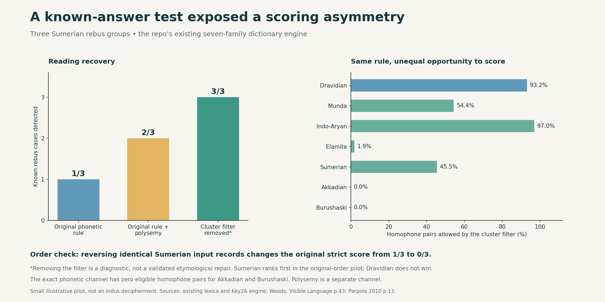

# Known-rebus positive control: language ranking, reading recovery and preprocessing bias

20 November 2026. Implemented after the large-vocabulary comparison. Existing Linear B/SumTablets structural comparators remain separate.

**The pilot ranks Sumerian first, but exposes a non-neutral preprocessing rule.** The existing strict phonetic scorer recovers **1/3** known Sumerian rebus cases; adding its existing distinct-sense polysemy channel detects **2/3**. Allowing distinct dictionary entries to match despite sharing a generated cluster recovers the expected forms in **3/3**. That removal is a diagnostic, not a validated etymological repair.

More seriously, the original exact phonetic channel has **zero eligible homophone edges for Akkadian and Burushaski** in these regenerated dictionaries. It is mechanically unable to register a positive distinct-cluster exact-phonetic result for either language on *any* supplied meaning pairs. Sumerian also has an input-order problem: reversing identical records changes its strict positive-control score **1/3 → 0/3**. These are concrete weaknesses in the comparative instrument, not a demonstration that Indus was or was not Dravidian.



## What was tested

Three independent sign groups were selected from published accounts of established Sumerian rebus uses. A fourth case, arrow/rib, shares the TI sign and is secondary, not a fourth independent sign.

| Case | Expected readings retained in the separate answer key | Original exact phonetic channel | Original phonetic + polysemy | Distinct-entry diagnostic |
|---|---|---:|---:|---:|
| TI: arrow → life/live | *ti* versus *ti/til* | Yes | Yes | Yes |
| GI: reed → return/reimburse | *gi* versus *gi/gi₄* | No | No | Yes |
| SAR: garden → write | *sar* versus *sar* | No | Yes | Yes |
| TI: arrow → rib, secondary | *ti* versus *ti* | No | No | Yes |

The answer key keeps the *ti/til* distinction. The scorer does not alter pronunciation rules to force this pair. The legacy lexicon itself offers a *ti* alias for the life entry, and the original engine can find it. The secondary arrow/rib case is also recovered by a liberal same-entry co-attestation screen, a different criterion from distinct-sense polysemy.

Primary sources:

- **Christopher Woods**, “The Earliest Mesopotamian Writing,” in *Visible Language*, printed **p. 43**, PDF p. 45: explicitly describes garden/write and reed/return uses. [Publisher and download](https://isac.uchicago.edu/publications/visible-language-inventions-writing-ancient-middle-east-and-beyond). The PDF page was downloaded, text-extracted and visually inspected.
- **Asko Parpola**, *A Dravidian solution to the Indus script problem* (2010), printed **p. 13**, PDF p. 12: arrow, life and rib example. [Paper](https://www.harappa.com/sites/default/files/pdf/Parpola-2010-Coimbatore.pdf). Read using web PDF extraction; local PDF retrieval returned HTTP 403.
- Modern lexical corroboration: [ORACC TI sign](https://oracc.museum.upenn.edu/epsd2/signlist/l0084/o0000553/index.html), [til/live](https://oracc.museum.upenn.edu/epsd2/cbd/sux/o0040362.html), [sar/garden](https://oracc.museum.upenn.edu/epsd2/cbd/sux/o0037663.html), and [gi/return](https://oracc.museum.upenn.edu/epsd2/praxis/cbd/sux/summaries.html). These corroborate readings; they were not added to a weak candidate dictionary after seeing its score.

These are established later Sumerian examples, not an assertion that every comparable sign had the same value in the earliest proto-cuneiform phase. This pilot does not date the emergence of each rebus.

## Answer withholding and scope

[cases.json](cases.json) fixes English/German semantic matching rules, cases and scoring conditions. [truth.json](truth.json) stores expected language and forms separately. **run.py never reads truth.json**. Only score.py opens it after candidate witnesses have been produced. The correct normalized forms are checked against actual witnesses, rather than counting every incidental match as successful recovery.

The analyst knew the familiar examples, had inspected the source code and had seen some lexical rows before the run. Therefore this is an **automated answer-withholding pilot**, not a human-blinded decipherment or preregistered study. Subsequent source-page corroboration did not change any case regex, expected form or primary scoring rule. Three sign groups are far too few for a broad accuracy claim.

The upstream Key2A normalizers, stem rule, gloss cleaner, CleanCognateLex class and eval_edges_vectorized function were reused unchanged. All seven primary family lexica were regenerated with the repository's own builders in an isolated external cache. No shared /tmp lexical files or original result tables were overwritten. The primary Dravidian pool is the repository's Tamil-first **pdrav_2branch_fixed**, not our larger modern-language comparison.

## Language ranking

| Candidate dictionary family | Primary cases with both semantic domains represented | Original exact hits /3 | Original exact + polysemy /3 | Distinct-entry diagnostic /3 |
|---|---:|---:|---:|---:|
| Sumerian | 3 | 1 | 2 | 3 |
| Dravidian | 3 | 0 | 0 | 0 |
| Munda | 3 | 0 | 0 | 0 |
| Indo-Aryan | 3 | 0 | 0 | 0 |
| Elamite | 0 | 0 | 0 | 0 |
| Akkadian | 2 | 0 | 0 | 0 |
| Burushaski | 0 | 0 | 0 | 0 |

Thus this pilot does **not** demonstrate an automatic tendency to call everything Dravidian. In its original input order, Sumerian is the unique highest-scoring candidate in all tested modes. The score gap is a raw pilot ranking, not a calibrated probability of language identity. Coverage is especially inadequate for Elamite and Burushaski; their zeros are not clean linguistic defeats.

[case_scores.csv](results/case_scores.csv), [language_scores.csv](results/language_scores.csv), [witnesses.csv](results/witnesses.csv) and [scored.json](results/scored.json) contain every result and recovered form.

## The cluster filter is not equivalent across languages

The engine enumerates pairs of entries sharing a normalized sound key. It then removes pairs whose **cluster IDs** are equal. That can sensibly suppress derivative duplicates only if cluster IDs mean comparable things across dictionaries. Here the builders use different heuristics: DEDR etymological groups/cross-references for Dravidian; normalized spelling or the first compound element for Sumerian; root/skeleton heuristics for other families.

| Family | Exact homophone edges before cluster filter | Eligible after filter | Eligible percentage |
|---|---:|---:|---:|
| Dravidian | 2,014 | 1,877 | 93.2% |
| Munda | 182 | 99 | 54.4% |
| Indo-Aryan | 405 | 393 | 97.0% |
| Elamite | 162 | 3 | 1.9% |
| Sumerian | 6,298 | 2,868 | 45.5% |
| Akkadian | 27 | 0 | 0.0% |
| Burushaski | 128 | 0 | 0.0% |

These percentages describe the **generated lexical representations**, not language quality, true homophony rates or probabilities of being the Indus language. They show unequal opportunities to score. In particular, an exact-phonetic zero for Akkadian or Burushaski is guaranteed by this representation and cannot, by itself, exclude either language.

For GI, both the reed and return entries get `SUM_gi`. For SAR, garden and write entries get `SUM_sar`. Their actual expected same-form connections are then rejected. The original polysemy channel rescues SAR through another combined entry; it does not rescue GI. [blocked_bridges.csv](results/blocked_bridges.csv) records the exact pairs and exclusions.

This criticism is specifically about the **distinct-cluster phonetic channels**. It does not mean that every other channel, such as same-entry polysemy or external loanword tests, is mechanically zero for those families.

## An order-only change removes the remaining strict success

The Sumerian source has **519 entry IDs associated with more than one source cluster ID** across their variant rows. CleanCognateLex stores the first cluster encountered for each entry, while accumulating all its sound variants. That lets row order determine whether a later variant is treated as belonging to a different cluster.

The TI life entry illustrates this: its variants include *tila*, *til* and *ti*. With the original order, the entry receives `SUM_tila`, so its *ti* variant can match the arrow's `SUM_ti`. Reversing the identical input records changes the first cluster and removes that surviving exact match.

The row-order diagnostic verifies equal record-multiset hashes. **Only order changes, yet Sumerian's strict score goes 1/3 → 0/3.** The other six families remain 0/3 on this small panel. This does not erase all polysemy evidence; it shows that this strict language-ranking result is not robust to an irrelevant formatting choice. See [row_order_sensitivity.csv](results/row_order_sensitivity.csv).

## Foil pairings and false matches

All six permutations of the three target meanings are scored. Two are full derangements, covering six off-diagonal picture/meaning pairings per language. The original strict phonetic channel and the distinct-entry diagnostic each produce **zero hits on these six foil pairings in every family**.

The most liberal same-entry co-attestation diagnostic produces **one Dravidian foil hit out of six**: reed → write. Its witness is DEDR 5171, *reḷḷu*, a reed used to write. That describes a use of the object, not a demonstrated phonetic rebus. This is why removing a cluster filter or accepting co-occurring gloss words cannot simply be declared a repaired decipherment method.

Foils are rearrangements, not independently authenticated false ancient readings. These six pairings do not estimate a general archaeological false-positive rate. Under all six permutations, the original Sumerian strict score ties or exceeds the observed score in 2/6 arrangements; the distinct-entry score does so in 1/6. The panel cannot support tiny p-values, and we did not manufacture thousands of independent controls by repeating its six permutations. Full results: [permutation_controls.csv](results/permutation_controls.csv).

## Diagnostic transfer to the repository's original 12-pair panel

After observing the positive-control failure, we applied the same cluster-gate removal to the **unchanged original Key2A CLEAN_WAVE2B_12** meaning pairs. This is a post-pilot sensitivity, not a new preregistered result or a full Key6 replication.

Original exact counts reproduce the committed table: **Dravidian 7/12, Sumerian 5/12**, other five families zero. Removing only the cluster exclusion gives **Dravidian 7/12, Sumerian 7/12, Burushaski 1/12**, with the remaining four still zero. These are raw match counts, **not new significance tests, validated translations, or evidence that Sumerian is the Indus language**. The changed null distribution and false-match burden must be recalculated before comparing language significance.

The correct conclusion is that the original competitive inference is sensitive to a non-neutral data-engineering choice. It needs a defensible, order-invariant definition of lexical identity and derivation across families, followed by a full rerun. Simply admitting all same-cluster matches is not automatically the right fix. See [indus12_cluster_sensitivity.csv](results/indus12_cluster_sensitivity.csv).

## What this means for the Dravidian hypothesis

The experiment **does contribute to testing the evidence for the hypothesis**. It identifies a specific way that some rivals are prevented from scoring and some known true readings are discarded. Consequently, zeros from those affected channels are not reliable grounds for language exclusion, and their apparent comparative advantage should not be treated as independently calibrated proof.

It does **not** show that the Indus language was non-Dravidian. Nor does the small positive language-ranking result validate the Indus English meanings: the benchmark supplies established semantic pairs, whereas the Indus pairs remain hypotheses. The new contribution is a reproducible counterexample and a concrete correction target for the comparative argument.

## Reproduce

Python 3.9–3.12; run from the repository root. Large source PDFs stay outside git; the candidate dictionaries already belong to the repository. Every run input and upstream code hash is retained in [run_inputs.json](results/run_inputs.json). Rebuilding the lexica took a few seconds; no Colab units were used.

```sh
python -m pip install -r research/independent_validation_20261120/rebus_positive_control/requirements.txt
python research/independent_validation_20261120/rebus_positive_control/run.py --cache /tmp/ivc-positive-lexica
python research/independent_validation_20261120/rebus_positive_control/score.py
python research/independent_validation_20261120/rebus_positive_control/indus_sensitivity.py --cache /tmp/ivc-positive-lexica
python research/independent_validation_20261120/rebus_positive_control/row_order_sensitivity.py --cache /tmp/ivc-positive-lexica
python research/independent_validation_20261120/rebus_positive_control/check.py
MPLCONFIGDIR=/tmp/ivc-positive-mpl python research/independent_validation_20261120/rebus_positive_control/plot.py
```

The diagnostics leave the original engine and dictionaries unchanged. A future repair must preserve legitimate duplicates/derivations while allowing known homophonous readings, and must be tested on a larger independently assembled benchmark.
