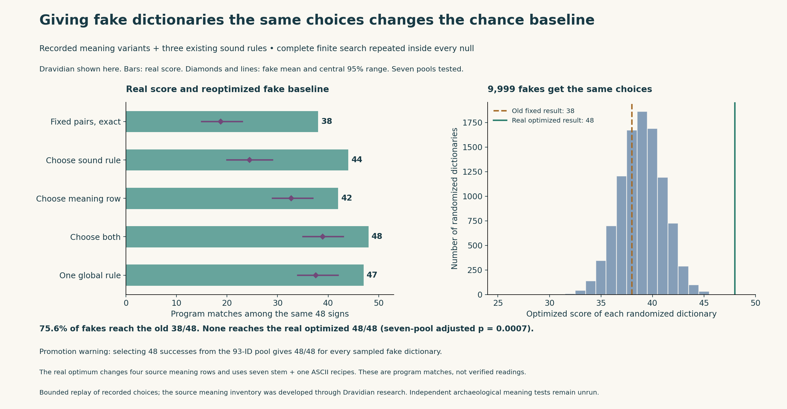

# Can the recorded rebus search manufacture a strong result?

20 November 2026 local. **The same meaning/sound search lets 75.6% of shuffled Dravidian dictionaries reach the old 38/48 count. The real dictionary reaches 48/48 under that expanded search; none of its 9,999 matched shuffled dictionaries reaches 48.** Correcting for the documented choices raises the chance baseline sharply but leaves an unusual real-dictionary fit within this bounded search universe.

There is a separate, stronger warning about candidate promotion: when allowed to retain any 48 successful sign IDs from the full 93-ID candidate pool, **every one of 9,999 shuffled Dravidian dictionaries produces 48/48 retained matches**, just as the real dictionary does. The uncapped totals retain information: **real 78/93 versus shuffled mean 64.98/93**, p=0.0004 before correction. A perfect retained success fraction alone is uninformative under that selection policy.



## What is new, and what was already in the repository?

The prior-work check happened before implementation. The [frozen plan](PLAN.md) records the inspected versions: our continuation at `6730965`, upstream `work` at `727dfd4`, and upstream `main` at `648417d`. Live upstream branch heads were checked.

**The general idea is not new to this repo.** [Sanskrit whole-inscription optimization](https://github.com/Cuuper22/ivc/blob/648417d7607b6df507ade950b637b37e0441c31c/research/extensions_20261001/phonetic_null/REPORT.md) already gives real and synthetic corpora the same optimizer budget. [Structural rewrite tests](https://github.com/Cuuper22/ivc/blob/648417d7607b6df507ade950b637b37e0441c31c/research/extensions_20261001/alternation_null/REPORT.md) already repeat selection inside decoy scans. `gsol_01_k1_audit.py` genuinely refits semantic bigram models per decoy. Key2A's rival audits and our six-panel comparison shuffle dictionaries against fixed meaning specifications.

What was not found implemented is this **seven-family rebus search that reselects among the recorded meaning-pair variants and normalizers inside every randomized dictionary, with candidate promotion evaluated under the same policy**. This is a repository-specific implementation contribution, not a claim of worldwide methodological novelty or a reconstruction of all historical human choices.

## Exactly what was allowed?

All **178 recorded rows** from the preceding six frozen inventories were retained, including failed candidates. These correspond to **93 distinct candidate sign IDs**. The primary target is the previous **48 representative signs**, with **122 source rows** available for those signs. Repeated or identical rows never earn extra points.

Each dictionary may choose a source-listed picture/meaning row and one of the existing exact-phoneme, stem, or ASCII normalizers. It may use the same source form alternatives and distinct-sense polysemy rule as before. The generated-cluster exclusion stays removed. The optimizer exhaustively searches the same finite options for every real and fake dictionary, rather than running a stochastic search longer for a favored language.

This is *bounded documented flexibility*: no new synonyms, arbitrary phonological transformations, cross-row mixing, visual reinterpretation, compound construction, archaeological outcome selection or new corpus labels were invented during the test. The source universe itself came from Dravidian-oriented research; unrecorded abandoned guesses cannot be recovered. A result surviving this replay is therefore conditional on that universe, not an independent archaeological validation or a full correction for every decision in the original project.

## The fair optimized-real versus optimized-random comparison

| Dictionary pool | Old fixed count /48 | Optimized real /48 | Optimized fake mean | Primary adjusted p | Cluster-null adjusted p |
| --- | --- | --- | --- | --- | --- |
| Dravidian | 38 | 48 | 38.95 | 0.0007 | 0.0007 |
| Sumerian | 11 | 26 | 28.92 | 1 | 1 |
| Munda | 0 | 7 | 3.03 | 0.1452 | 0.3516 |
| Indo-Aryan | 1 | 4 | 2.07 | 0.3984 | 0.3516 |
| Elamite | 0 | 0 | 0.14 | 1 | 1 |
| Akkadian | 3 | 5 | 4.39 | 0.9204 | 1 |
| Burushaski | 0 | 2 | 0.28 | 0.2065 | 1 |

Each number counts successful primary **sign IDs**, with one point per sign, out of 48. Success means an allowed dictionary/sense match under a selected source row and sound rule; it does not mean an ancient translation was independently recovered. Both nulls move whole gloss/sense bundles, preserving ordinary polysemy. The primary null stratifies by form length and number of forms; the secondary preserves the original source clusters. Both rerun the entire finite selection policy.

For Dravidian, the primary randomized mean is **38.95**, with central 95% range **35–43** and maximum **46**. The real score is **48**. There are zero randomized scores at least 48, giving Monte Carlo p=(1+0)/10000=**0.0001**, or **0.0007 after the seven primary languages**. The legacy-cluster null also gives p=0.0007 after correction. The larger-of-two-null primary sensitivity remains p=0.0007. Across all **49 genuine policy/family endpoints**, Dravidian's primary p adjusts to **0.0049** under either null.

These are finite Monte Carlo results, not exact tail probabilities or probabilities that Indus was Dravidian. The real score of 48 is larger than every sampled null score, but the null does not include every source-selection bias or every linguistic alternative. Other language zeros remain affected by dictionary coverage and parsing; they are not definitive exclusions.

## How much does each choice buy?

| Search policy | Real score | Fake mean | Fakes ≥ real | Unadjusted p |
| --- | --- | --- | --- | --- |
| Fixed meanings, exact sounds | 38 | 18.76 | 0/9999 | 0.0001 |
| Sound rule chosen per sign | 44 | 24.44 | 0/9999 | 0.0001 |
| Meaning row chosen per sign | 42 | 32.69 | 0/9999 | 0.0001 |
| Both choices per sign (primary) | 48 | 38.95 | 0/9999 | 0.0001 |
| Meaning choices + one global sound rule | 47 | 37.57 | 0/9999 | 0.0001 |
| Promote 48 from all 93 candidates | 48 | 48.00 | 9999/9999 | 1 |
| Uncapped successful candidate IDs | 78 | 64.98 | 3/9999 | 0.0004 |

The table uses the primary entry-stratified null. Every row applies its policy identically to real and randomized dictionaries. “Sound rule” includes the existing stem and ASCII sensitivities; these are more permissive than exact sound identity. “Meaning choice” selects among whole source rows, retaining their published synonym lists. It does not freely combine unrelated A and B fragments.

Holding the real dictionary's winning recipes fixed during randomization gives a naive chance mean of **20.50/48**. Letting the fake dictionaries reselect recipes raises it to **38.95/48**. The fixed-winner procedure understates the opportunity provided by selection. Its apparent p is deliberately labeled **naive**, not counted as a valid selection-adjusted endpoint.

## Why the old 38/48 threshold can now be misleading

Under full meaning-and-sound reselection, **7561 of 9,999** shuffled Dravidian dictionaries reach at least 38/48 (**75.6%**). Under the cluster-preserving null the corresponding count is **6452/9,999 (64.5%)**. Under the original fixed48 policy, none reaches 38 in this run.

That comparison answers whether the old raw match total can be obtained after allowing these choices. It is **not** the p-value for the new real optimum. The real dictionary gets the same additional choices and reaches 48, so the correct primary comparison is **48 versus reoptimized null scores**, not real 38 versus optimized fakes.

The promotion result makes the denominator issue explicit: in the primary null all **9,999/9,999** fake dictionaries can promote 48 successes from the 93 candidate IDs. Retaining only successful candidates produces a perfect retained score even under randomized sound assignments. We therefore publish the uncapped yield as well: only **3/9,999** primary fakes reach the real total of 78 (p=0.0004; global 49-endpoint Holm p=0.0176). Under the legacy-cluster null, 2/9,999 do so (p=0.0003; global Holm p=0.0132). These are candidate-ID yields, not counts of independent meanings: the source pool contains related signs/allographs and shared concepts, which are retained jointly in the null.

## What changed to obtain the 48 real matches?

The chosen Dravidian recipes use **40 exact**, **seven stem**, and **one ASCII** normalizer. **Four signs change to a different source meaning-pair row.** Thus “48/48 under flexible search” must not be described as “48 original meanings verified with exact sounds.”

| Sign | Original proposal | Chosen semantic alternatives | Sound rule |
| --- | --- | --- | --- |
| 220 | fish → star | fish / fishes / carp → star / stars / constellation / planet / asterism / shine / glitter / flash | phon_exact |
| 520 | spear → chief | arrow / dart / spear / lance → field / allotment / share / portion / estate | phon_stem |
| 850 | eye → copper | eye / eyes / sight / pupil / vision → copper / bronze / metal / brass / ore / blade / axe / chisel | phon_stem |
| 540 | drum ↔ capacity measure | drum / waist / cone → measure / capacity / bushel / oil / ration | phon_exact |

In particular, the fish pair may use **shine/glitter**, not just star. For sign 520, the source alternative is **arrow paired with field/allotment/share/portion/estate**, not the original spear/chief reading. Its selected witness links *tūṇṭu*, whose gloss includes **propel an arrow**, with *tuṇṭam*, whose gloss includes **small plot of field**, under the stem rule. The first is a verb mentioning an arrow, not an established noun meaning arrow: this exposes a further word-sense error in the keyword-based instrument. For 540 the source alternatives admit **waist → measure**, which is not confirmation of drum → capacity. Jar/house instead uses the existing stem rule; sit/tribute uses ASCII normalization. These are precisely the kinds of choices that must also be available to controls.

All 336 chosen primary recipes are in [chosen_readings.csv](results/chosen_readings.csv). Their actual lexical word pairs and definitions are in [selected_word_witnesses.csv](results/selected_word_witnesses.csv), linked back to the preceding experiment's unchanged source dictionaries and full witness table. [candidate_promotions.csv](results/candidate_promotions.csv) retains all 651 family/candidate rows, including failures and unpromoted candidates. A keyword match remains subject to word-sense errors such as the previously documented comb/small-bunch example; this experiment tests the automated search, not semantic annotation accuracy.

## What this says about the hypothesis

**Documented flexibility matters greatly:** it nearly doubles the primary chance expectation compared with fixed meanings/exact sounds, and makes 38 matches common in randomized Dravidian dictionaries. Counts reported only after discarding failed candidates can be perfectly reproduced by every sampled fake dictionary.

**That flexibility does not fully explain the observed dictionary fit within this search universe:** the real Dravidian dictionary still exceeds the reoptimized controls on the fixed 48-sign target and on uncapped candidate yield. This residual result favors continuing to test the hypothesis rather than treating the diagnosed filter or these recorded choices as a complete explanation of its lexical fit.

The remaining distinction is between **dictionary fit to a Dravidian-oriented inventory of possible meanings** and **correct meanings of actual Indus signs**. This study tests the former with a stronger null. It does not supply the latter. Independent semantic assignment and predictions on archaeological outcomes remain the route to breaking that circularity.

## Reproduce and verify

The calculation used Python 3.9.6 and the preceding NumPy 1.26.4/Matplotlib 3.9.4 environment. It completed in **51.44 seconds** locally, within the repository's roughly two-minute computation rule; no Colab units were used. Use the repository root:

```sh
python -m pip install -r research/independent_validation_20261120/expanded_rebus_test/requirements.txt
python research/independent_validation_20261120/rebus_positive_control/run.py --cache /tmp/ivc-positive-lexica
OPENBLAS_NUM_THREADS=1 VECLIB_MAXIMUM_THREADS=1 python research/independent_validation_20261120/selection_aware_rebus/run.py --cache /tmp/ivc-positive-lexica --n 9999
python research/independent_validation_20261120/selection_aware_rebus/check.py --cache /tmp/ivc-positive-lexica
MPLCONFIGDIR=/tmp/ivc-positive-mpl python research/independent_validation_20261120/selection_aware_rebus/present.py
```

Presentation additionally reads the preceding committed expanded_rebus_test witness table, after verifying identical source-case and generated-dictionary hashes. No original dictionary or upstream scorer was edited.

Checks passed: exhaustive optimizer against explicit candidate/normalizer loops; duplicated-row invariance; failure retention and selected sign identity; nested-policy monotonicity; exact replay of initial null draws from every seed/family/baseline; fixed48 count reproduction; source/code hashes; all **112 result cells**, **336 chosen primary rows**, **651 candidate rows**; and Monte Carlo/multiplicity calculations. All score arrays are in [search_nulls.npz](results/search_nulls.npz), cell summaries in [summary.csv](results/summary.csv), and inputs/seeds/runtime in [run.json](results/run.json).
